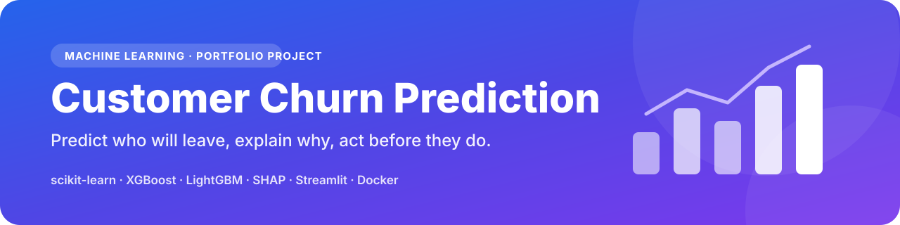
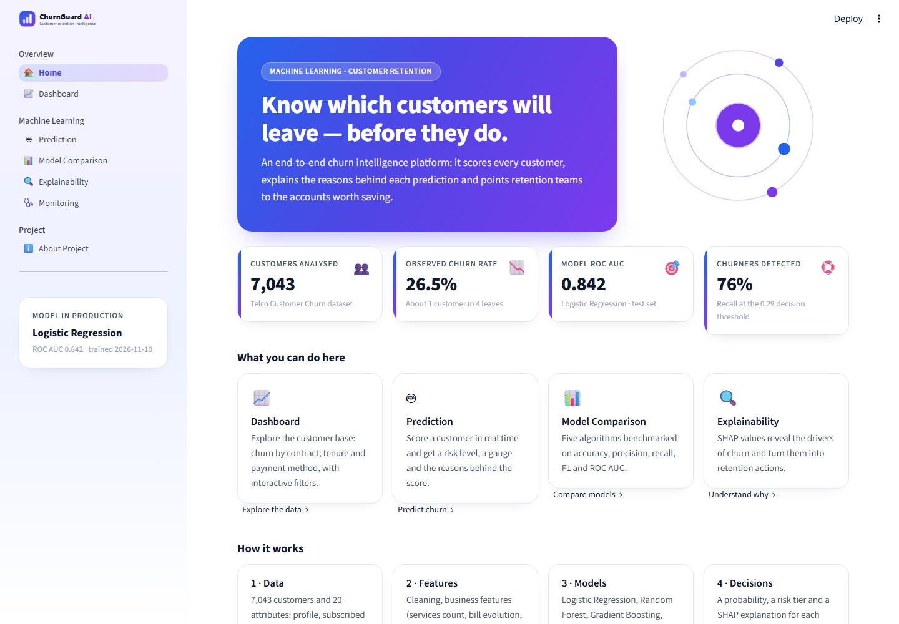
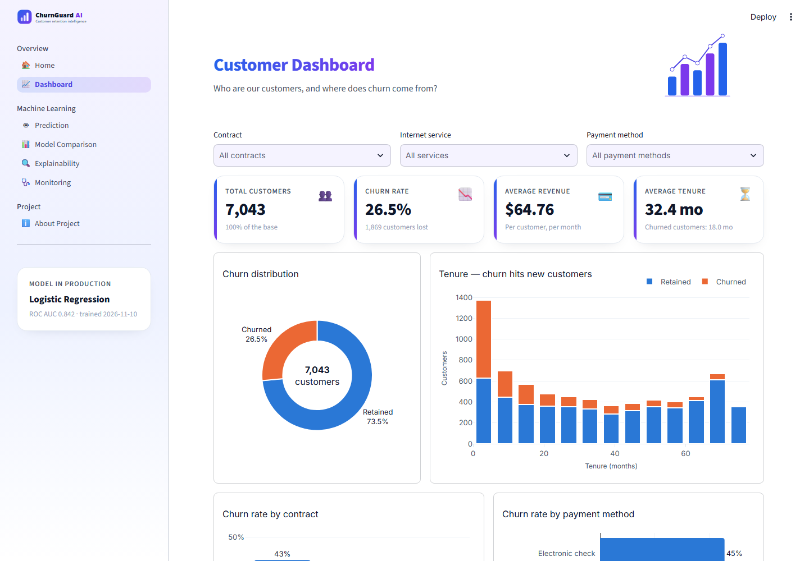
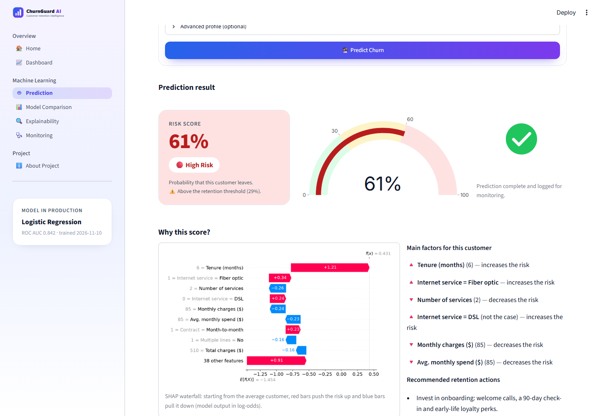
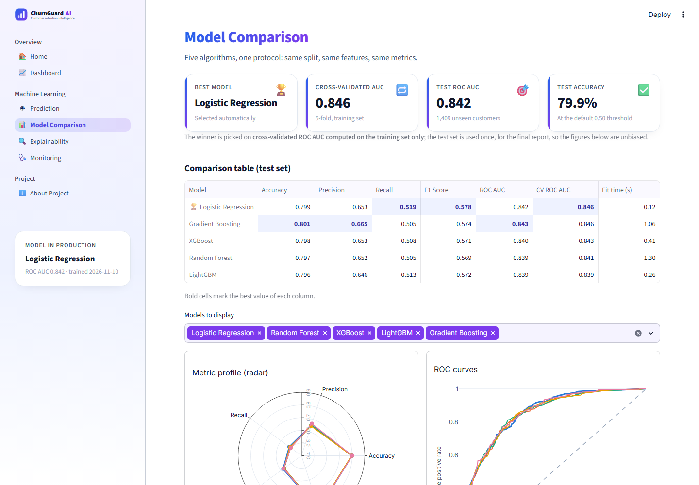
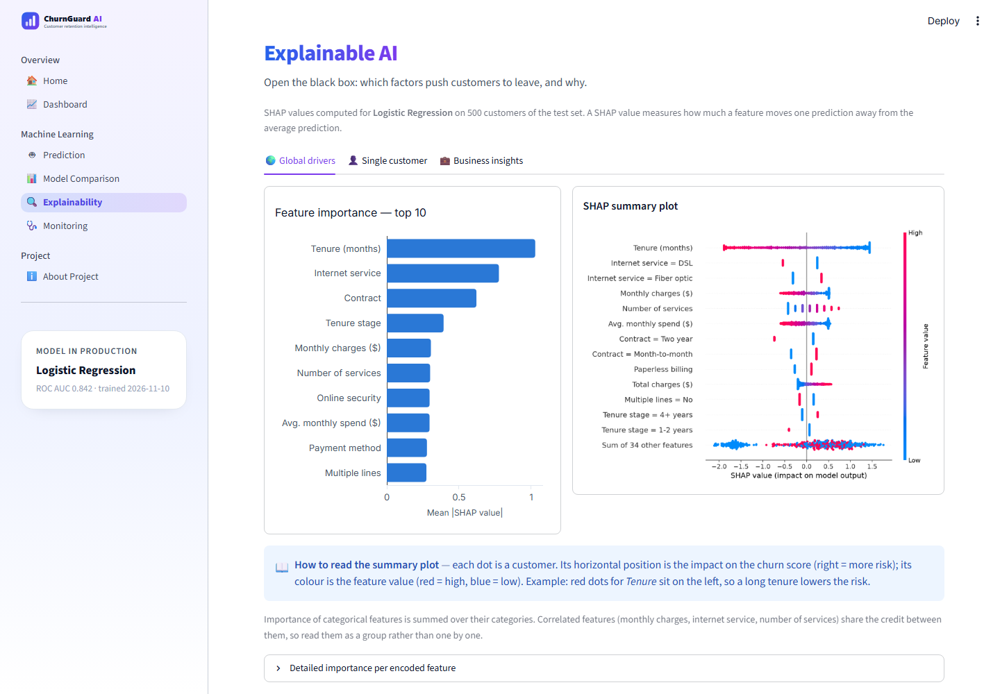
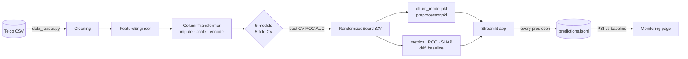

<p align="center">
  
</p>

<p align="center">
  
  
  
  
  
  
  
  
</p>

# Customer Churn Prediction — Machine Learning Project

An end-to-end machine learning system that **predicts which customers are about to leave**, **explains why**, and serves the result in a **Streamlit web app** built for retention teams.

> **In one sentence:** five models benchmarked on the Telco Customer Churn dataset, the best one tuned and explained with SHAP, then shipped as a Dockerised multipage app with real-time scoring and drift monitoring.

---

## Table of contents

- [Business context](#business-context)
- [Results](#results)
- [Screenshots](#screenshots)
- [Architecture](#architecture)
- [Project structure](#project-structure)
- [Installation](#installation)
- [Run locally](#run-locally)
- [Docker](#docker)
- [Deploy on Streamlit Community Cloud](#deploy-on-streamlit-community-cloud)
- [Methodology](#methodology)
- [Engineering practices](#engineering-practices)
- [Limits and next steps](#limits-and-next-steps)

---

## Business context

Winning a new customer costs far more than keeping an existing one. A telecom operator wants to spot at-risk customers **before** they cancel, so the retention team can act with the right offer.

The system answers four questions:

| Question | Answer in the app |
|---|---|
| Who is going to leave? | Real-time churn probability and risk tier (🟢 Low / 🟠 Medium / 🔴 High) |
| Why? | SHAP explanation of every prediction |
| Which model should we trust? | Benchmark of five algorithms on five metrics |
| Is the model still valid? | Prediction log and data-drift report (PSI) |

**Dataset** — [IBM Telco Customer Churn](https://github.com/IBM/telco-customer-churn-on-icp4d): 7,043 customers, 20 attributes (profile, services, contract, billing), 26.5% churners. It is downloaded automatically by `src/data_loader.py`.

## Results

Test set of 1,409 customers never seen during training or model selection (threshold 0.50):

| Model | Accuracy | Precision | Recall | F1 | ROC AUC | CV ROC AUC |
|---|---:|---:|---:|---:|---:|---:|
| **Logistic Regression** 🏆 | 0.799 | 0.653 | **0.519** | **0.578** | 0.842 | **0.846** |
| Gradient Boosting | **0.801** | **0.665** | 0.505 | 0.574 | **0.843** | 0.846 |
| XGBoost | 0.798 | 0.653 | 0.508 | 0.571 | 0.840 | 0.843 |
| Random Forest | 0.797 | 0.652 | 0.505 | 0.569 | 0.839 | 0.841 |
| LightGBM | 0.796 | 0.646 | 0.513 | 0.572 | 0.839 | 0.839 |

**Reading the results honestly**

- All five models land within one AUC point: on this small tabular dataset the signal is mostly linear, so the **simplest and most interpretable model wins** the cross-validated selection.
- `RandomizedSearchCV` (25 candidates × 5 folds) did not beat the default hyper-parameters, so the default configuration was kept — the pipeline only adopts a tuned model when cross-validation says it is better.
- With 26.5% churners, the default 0.50 threshold misses half of them. A **decision threshold tuned on out-of-fold predictions (0.29)** changes the picture:

| Threshold | Recall | Precision | F1 |
|---|---:|---:|---:|
| 0.50 (default) | 51.9% | 65.3% | 0.578 |
| **0.29 (tuned)** | **76.5%** | 51.9% | **0.618** |

→ the model catches **3 churners out of 4**, at the price of more false alarms. Where to put the cursor is a business decision (cost of an offer vs value of a saved customer).

**Main churn drivers (SHAP)** — short tenure, month-to-month contract, fiber-optic internet, electronic-check payment, no tech support / online security.

> Figures come from `reports/metrics.json` and `reports/metadata.json`; run `python -m src.train` to regenerate them.

## Screenshots

| Home | Dashboard |
|---|---|
|  |  |

| Prediction | Model comparison |
|---|---|
|  |  |

| Explainability |
|---|
|  |

Screenshots are produced by `python scripts/capture_screenshots.py` while the app is running.

## Architecture



| Layer | Module | Responsibility |
|---|---|---|
| Data | `src/data_loader.py` | Download (2 mirrors), schema validation |
| Features | `src/preprocessing.py` | Cleaning, `FeatureEngineer`, `ColumnTransformer` pipeline |
| Training | `src/train.py` | Cross-validation, selection, tuning, persistence |
| Evaluation | `src/evaluate.py` | Metrics, ROC curves, threshold optimisation |
| Explainability | `src/explain.py` | SHAP values, plots, business insights |
| Monitoring | `src/monitoring.py` | Prediction log, PSI drift report |
| App | `main.py`, `app/` | Navigation, pages, shared UI toolkit |

## Project structure

```
customer-churn-prediction/
├── app/                          # Streamlit pages
│   ├── Home.py
│   ├── Dashboard.py
│   ├── Prediction.py
│   ├── Model_Comparison.py
│   ├── Explainability.py
│   ├── Monitoring.py
│   ├── About.py
│   └── ui.py                     # design system: CSS, KPI cards, Plotly theme, loaders
├── assets/
│   ├── images/                   # banner, logo, screenshots
│   └── lottie/                   # ai.json, robot.json, analytics.json, success.json
├── data/
│   └── telco_customer_churn.csv  # downloaded automatically
├── models/
│   ├── churn_model.pkl
│   └── preprocessor.pkl
├── notebooks/
│   └── churn_analysis.ipynb      # full EDA (Plotly + Seaborn)
├── reports/                      # metrics, ROC curves, SHAP values, drift baseline
├── scripts/
│   ├── build_notebook.py         # regenerates and executes the notebook
│   ├── capture_screenshots.py    # README screenshots
│   └── generate_lottie.py        # builds the Lottie animations
├── src/
│   ├── config.py                 # paths, constants, logging
│   ├── data_loader.py
│   ├── preprocessing.py
│   ├── train.py
│   ├── evaluate.py
│   ├── explain.py
│   └── monitoring.py
├── tests/
│   └── test_pipeline.py
├── .github/workflows/ci.yml      # lint · tests · training smoke test · Docker build
├── .streamlit/config.toml        # blue / violet / white theme
├── main.py                       # app entry point
├── Dockerfile
├── requirements.txt
├── requirements-dev.txt
├── pyproject.toml
├── LICENSE
└── README.md
```

## Installation

Requirements: Python 3.11 or newer.

```bash
git clone https://github.com/your-username/customer-churn-prediction.git
cd customer-churn-prediction

python -m venv .venv
source .venv/bin/activate        # Windows: .venv\Scripts\activate

pip install -r requirements.txt
```

## Run locally

```bash
# 1. (optional) download the data and retrain the models — about 30 seconds
python -m src.data_loader
python -m src.train

# 2. launch the app
streamlit run main.py
```

Open <http://localhost:8501>. If the model files are missing, or were pickled with another scikit-learn version, the app retrains automatically on first launch.

Other useful commands:

```bash
python -m src.evaluate                 # print the comparison table
python scripts/build_notebook.py       # rebuild + execute the EDA notebook
pip install -r requirements-dev.txt    # dev tools
pytest -q                              # unit tests
ruff check .                           # lint
```

## Docker

```bash
docker build -t churn-app .
docker run --rm -p 8501:8501 churn-app
```

The image is based on `python:3.11-slim`, trains the model at build time (so the pickles always match the installed libraries), runs as a non-root user and exposes a health check on `/_stcore/health`.

## Deploy on Streamlit Community Cloud

1. Push the project to a **public GitHub repository** (keep `data/`, `models/` and `reports/` versioned — they are small).
2. Go to <https://share.streamlit.io> and sign in with GitHub.
3. Click **Create app → Deploy a public app from GitHub**.
4. Fill in the form:
   - **Repository**: `your-username/customer-churn-prediction`
   - **Branch**: `main`
   - **Main file path**: `main.py`
5. Open **Advanced settings** and select **Python 3.11**.
6. Click **Deploy**. Dependencies are installed from `requirements.txt`; the theme comes from `.streamlit/config.toml`.

On the first boot the app checks the saved model against the installed scikit-learn version and retrains itself if they differ (about one minute). Note that the Community Cloud file system is ephemeral: the prediction log used by the Monitoring page is reset whenever the app restarts.

## Methodology

1. **EDA** — [`notebooks/churn_analysis.ipynb`](notebooks/churn_analysis.ipynb): data quality (11 blank `TotalCharges` for brand-new customers), churn by contract / tenure / charges, correlation matrix.
2. **Preprocessing** — one scikit-learn `Pipeline`, identical at training and inference:
   - `FeatureEngineer`: `AvgMonthlySpend`, `ChargeDelta`, `NumServices`, `TenureGroup`
   - numeric → median imputation + `StandardScaler`
   - binary → label (ordinal) encoding
   - nominal → one-hot encoding (`handle_unknown="ignore"`)
3. **Model comparison** — Logistic Regression, Random Forest, Gradient Boosting, XGBoost, LightGBM; stratified 80/20 split and 5-fold cross-validation with the preprocessing re-fitted inside every fold (no leakage).
4. **Selection and tuning** — best cross-validated ROC AUC, then `RandomizedSearchCV`; the test set is only used for the final report.
5. **Decision threshold** — chosen on out-of-fold predictions to maximise F1.
6. **Explainability** — SHAP feature importance, summary (beeswarm) plot and per-customer waterfall plot, translated into retention actions.

## Engineering practices

- **Modular code** with full type hints and docstrings
- **Central configuration** (`src/config.py`) and rotating **logs** (`logs/app.log`)
- **Error handling**: dataset mirrors, per-model failure isolation, SHAP fallback explainer, graceful UI degradation (missing Lottie file, missing artefacts)
- **Monitoring**: every prediction is logged; Population Stability Index against the training baseline
- **Tests** (`pytest`) on preprocessing, metrics and drift; **CI** with GitHub Actions (lint, tests, training smoke test, Docker build)
- **Accessible charts**: colour-blind-safe data palette, direct labels, status always shown with icon + text

## Limits and next steps

- The dataset is a static snapshot: no dates, so seasonality and time-to-churn cannot be modelled.
- Scores are correlations, not causes — the effect of a retention action should be measured with an A/B test.
- Docker image and Streamlit Cloud deployment are configured but should be validated in your own environment.
- Ideas: probability calibration, uplift modelling to target *persuadable* customers, FastAPI endpoint for CRM integration, experiment tracking with MLflow.

## License

Released under the [MIT License](LICENSE).

## Author

**Your Name** — [GitHub](https://github.com/your-username) · [LinkedIn](https://www.linkedin.com/in/your-profile)
